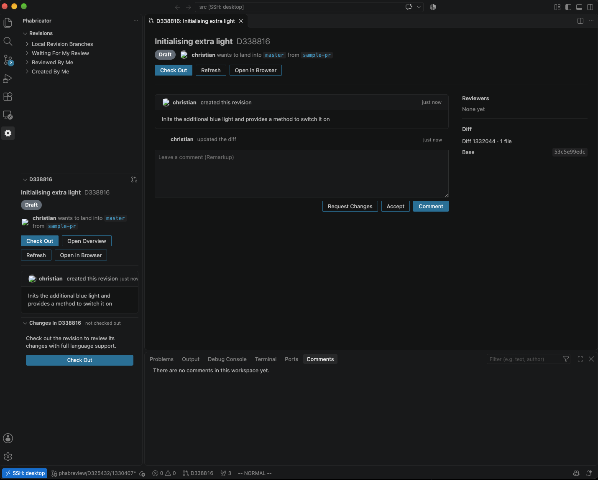
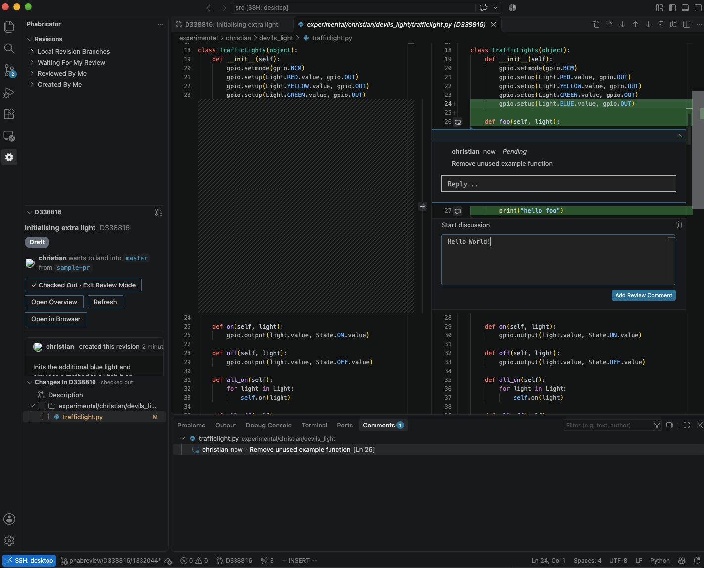

# Phabricator Review for VS Code

<p>
  
  
</p>

Review Phabricator revisions in VS Code. The extension checks the diff out onto
a local branch, so you review real files with go to definition, find references
and everything else your language server offers. Besides this, you can also
view and add inline comments and send them to Phabricator.

## Compatibility

Built and tested against [Phorge](https://phorge.it). Other Phabricator installs
that expose the stock Conduit API may work, but Mozilla's customised fork
hasn't been tested.

## Setup

You need a Conduit token in `~/.arcrc` (`arc install-certificate`) and a
repository whose `.arcconfig` sets `phabricator.uri`. If it doesn't, set
`phabreview.host`.

## Reviewing a revision

1. Open the Phabricator view in the activity bar and click a revision, or run
   **Phabricator: Open Revision…** with `D12345`, `12345` or a URL. The
   revision's overview opens in an editor tab.
2. Click **Check Out**. This creates `phabreview/D<revision>/<diff>` at the
   diff's base commit and commits the diff on top. Your working tree must be
   clean.
3. Go through the files in **Changes**. Each one opens as a diff against the
   base commit, with the real file on the right. Tick files off as you go.
4. Add inline comments with the `+` in the gutter. They are saved as drafts and
   published with your review.
5. Comment, accept or request changes from the overview or the **Active
   Revision** view.
6. **Exit Review Mode** takes you back to the branch you were on.

`Alt+F5` and `Shift+Alt+F5` jump to the next and previous change, across files.

## Limitations

These come from what the stock Conduit API supports.

- Comments can only be added to the new side of the diff.
- Replies can't be threaded. They are added as new comments on the same lines
  and shown together.
- You can't mark comments as done or delete drafts from VS Code. Use the web UI.
- Drafts you created in the web UI don't show up.

## Development

```sh
npm install
npm run compile  # compile
npm test         # compile and run the unit tests
npm run package  # build the .vsix
```

Press F5 in VS Code to start an Extension Development Host.
